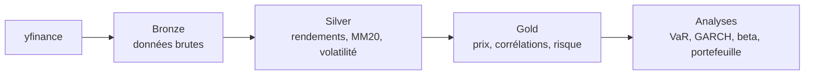

# Financial Data Platform


Pipeline de données financières de bout en bout (ingestion, transformation, analyse de risque) sur 8 actions américaines et le benchmark SPY, avec une fenêtre glissante de 10 ans.

## Résultats clés

| Analyse | Résultat |
|---|---|
| Queues épaisses | Kurtosis en excès de 4,3 (GOOGL) à 15,3 (SPY) : la normalité sous-estime le risque extrême |
| VaR (SPY, 99%) | Historique 3,29 %, paramétrique 2,58 %, Expected Shortfall 4,88 % |
| Backtest de Kupiec (SPY, fenêtre 250 j) | À 95 %, historique et paramétrique passent. À 99 %, les deux sont rejetés (1,68 % et 2,92 % d'exceptions pour 1 % attendu) |
| GARCH(1,1) | Persistance 0,973, corrélation de 0,918 avec la volatilité glissante à 20 jours, pic détecté 10 jours plus tôt en mars 2020 |
| Beta glissant (250 j) | Instable : XOM varie de -0,57 à 1,33, AMZN de 0,64 à 1,88 |
| Alpha (modèle de marché) | Positif pour 7 actions sur 8 mais aucun significatif (p > 0,18) |
| Diversification | Portefeuille équipondéré : volatilité 18,05 %, soit 32 % de moins que la moyenne pondérée des volatilités |
| Variance minimale | Volatilité 15,08 % (JNJ 35 %, PG 34 %), contre 18,05 % en équipondéré |

## Architecture



## Modules

| Fichier | Rôle |
|---|---|
| `src/config.py` | Tickers, benchmark, fenêtre de 10 ans |
| `src/ingest.py` | Téléchargement yfinance vers `data/raw/` |
| `src/transform.py` | Features silver : rendement log, MM20, volatilité |
| `src/gold.py` | Tables gold : prix, corrélations, résumé |
| `src/quality.py` | Contrôles qualité (doublons, prix, trous, extrêmes) |
| `src/risk.py` | VaR historique et paramétrique, Expected Shortfall |
| `src/backtest.py` | Backtest glissant et test de Kupiec, VaR GARCH-t |
| `src/garch.py` | Ajustement GARCH(1,1) et comparaison de volatilité |
| `src/beta.py` | Beta glissant vs SPY |
| `src/alpha.py` | Régression du modèle de marché (alpha, beta, R²) |
| `src/portfolio.py` | Risque du portefeuille, variance minimale |
| `src/pipeline.py` | Orchestration ingestion, silver, gold |

## Méthodologie et limites

- **Pas de look-ahead** : le backtest calcule chaque VaR uniquement sur les jours précédents.
- **Résultats du backtest nuancés** : avec une fenêtre de 1000 jours, les trois méthodes passent à 99 % (peu de puissance, environ 15 exceptions attendues). À 95 %, historique et paramétrique sont alors trop prudentes. La comparaison des fenêtres sur une même période de test reste à faire.
- **Alpha** : alpha du modèle de marché sur log-rendements, sans taux sans risque.
- **Optimisation en échantillon** : les poids de variance minimale sont estimés et évalués sur la même période, donc le résultat est optimiste.
- Les 8 actions sont de grandes capitalisations survivantes (biais de sélection).

## Lancer le projet

```powershell
python -m venv venv
venv\Scripts\activate
pip install -r requirements.txt
python src\pipeline.py
python -m pytest
```

Pour générer la série de volatilité GARCH consommée par l'onglet du dashboard, exécuter après le pipeline :

```powershell
python src\garch.py
streamlit run dashboard\app.py
```

## Prochaines étapes

- Dashboard Streamlit
- Logging et exécution planifiée